# Sprint 2 - Implement Database and Display of Test Data

## Sprint Goals

Implement the database, populated with test data. Create queries that retrieve test data, and display this on web pages as needed. Test and refine the queries and data display, so that it stands as the basis of the next sprint.

### Specific Goals

- Implement the database
- Add test data to the database
- Create the following web pages:
    - Login page
    - Ballot page for users casting vote
    - Admin page for NZART employees to input member data
    - Election management page for Election Officer
    - Candidate management page for Election Officer

- Develop SQL database queries to:
    - Submit votes
    - Add and edit candidate information
    - Add and edit user details
    - Display vote totals
    - Display user account status 
    - Etc.

## Initial DB schema:
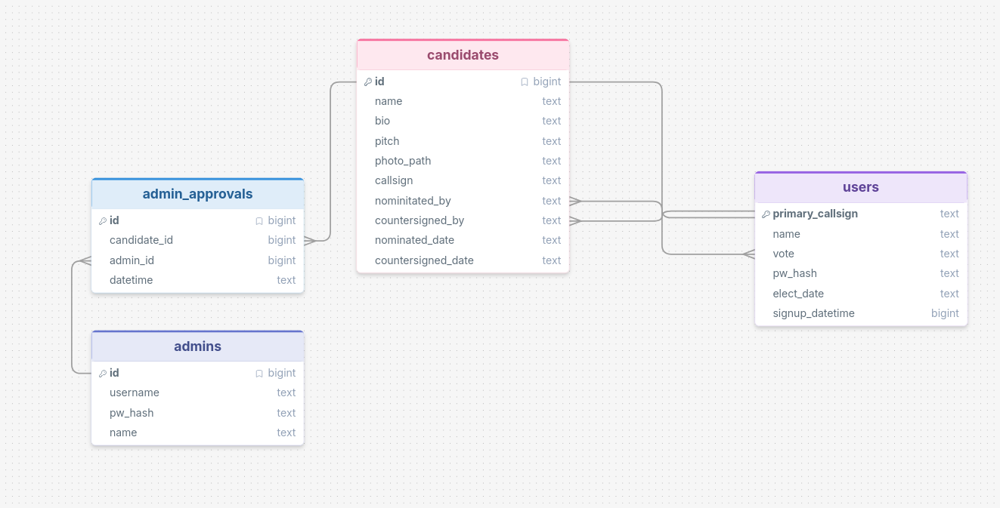

## Testing Adding Varied Natural Member Data

NZART members can have multiple callsigns which causes a problem for our system as although they are unique, they could end up with multiple accounts and thus cast a disproportionate amount of votes as the callsign is the primary key for the users.

### Changes / Improvements

Due to this conflict, Debby suggested that primary callsigns are not in fact the best primary key to use and instead we could switch to using NZART membership IDs as there is guaranteed to only be one per financial member.

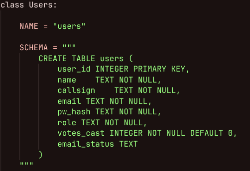

This was shown and explained to the council who questioned whether the approvals feature was actually needed if the candidate approvals can be handled by an ultimately trusted election officer who can also be responsible for setting election parameters which also need to be stored in the db. This person also already exists in the organisation and is usually responsible for counting votes sent in via mail etc.

This leads to the following db design v2:
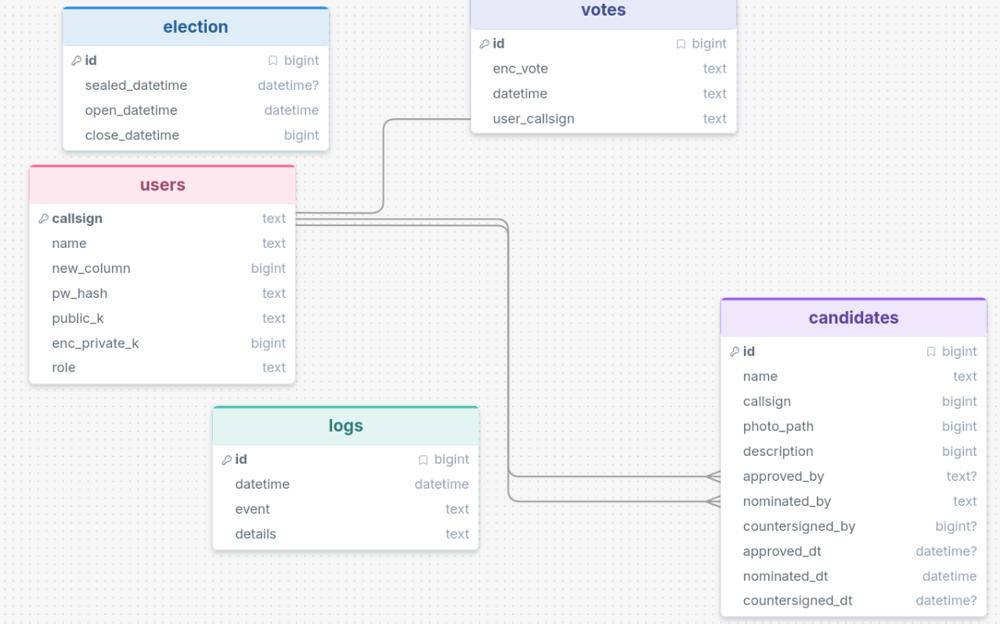

However, the candidate table can be made more efficient by relating it to the existing users table as all candidates will be NZART members.
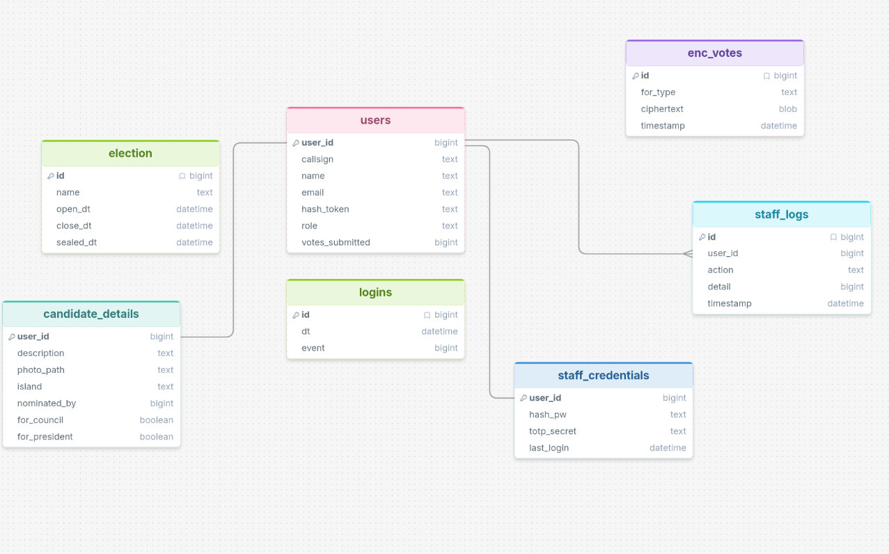

However, on a later meeting Cam suggested that the homomorphic encryption for the voting was too complicated and ultimately not in the threat scope of the system so we can update the system requirements and db to match.

## Testing Users (Adding, Deleting, Viewing, Searching, Editing)

The NZART admin secretary needs to be able input the member list, edit and resend any incorrect emails and delete users for further control.

### Adding/Viewing/Searching users

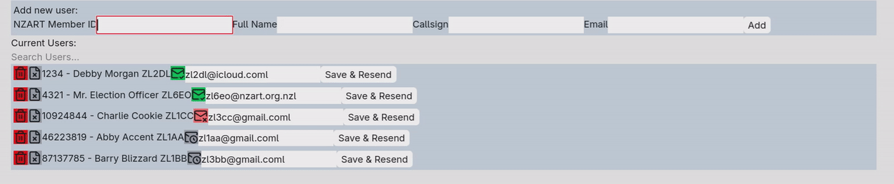

### Editing user email and resending

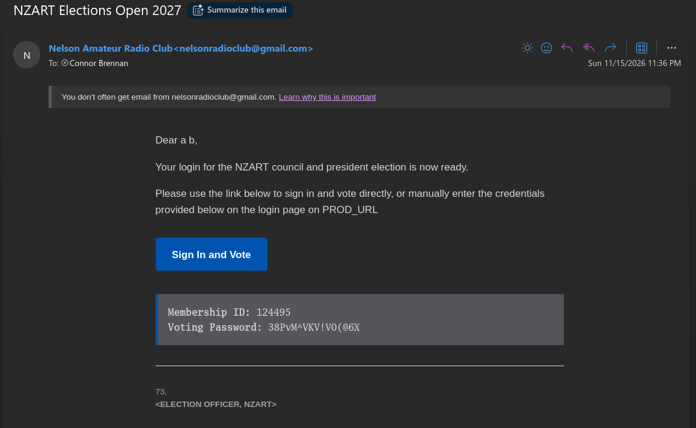

### Deleting User

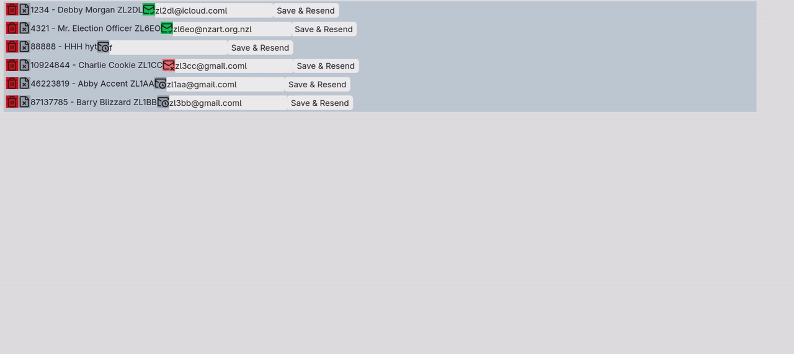

### Changes / Improvements

Replace this text with notes any improvements you made as a result of the testing.

**PLACE SCREENSHOTS AND/OR ANIMATED GIFS OF THE IMPROVED SYSTEM HERE**

## Testing Submitting Voting Ballots

Replace this text with notes about what you are testing, how you tested it, and the outcome of the testing

**PLACE SCREENSHOTS AND/OR ANIMATED GIFS OF THE TESTING HERE**

### Changes / Improvements

Replace this text with notes any improvements you made as a result of the testing.

**PLACE SCREENSHOTS AND/OR ANIMATED GIFS OF THE IMPROVED SYSTEM HERE**

## Testing Viewing Voting Results

Replace this text with notes about what you are testing, how you tested it, and the outcome of the testing

**PLACE SCREENSHOTS AND/OR ANIMATED GIFS OF THE TESTING HERE**

### Changes / Improvements

Replace this text with notes any improvements you made as a result of the testing.

**PLACE SCREENSHOTS AND/OR ANIMATED GIFS OF THE IMPROVED SYSTEM HERE**

## Testing Candidates

Replace this text with notes about what you are testing, how you tested it, and the outcome of the testing

**PLACE SCREENSHOTS AND/OR ANIMATED GIFS OF THE TESTING HERE**

### Changes / Improvements

Replace this text with notes any improvements you made as a result of the testing.

**PLACE SCREENSHOTS AND/OR ANIMATED GIFS OF THE IMPROVED SYSTEM HERE**

## Testing Updating Election Info

The election officer should be able to update the starting and ending datetime of the election by modifying them and pressing save but even though the updated successful message appears, the records are not updated.
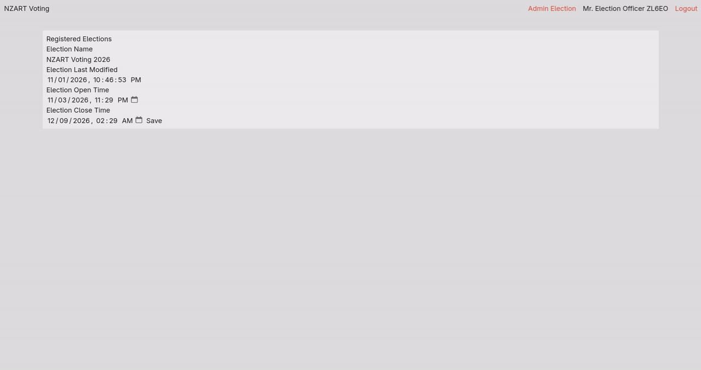

### Changes

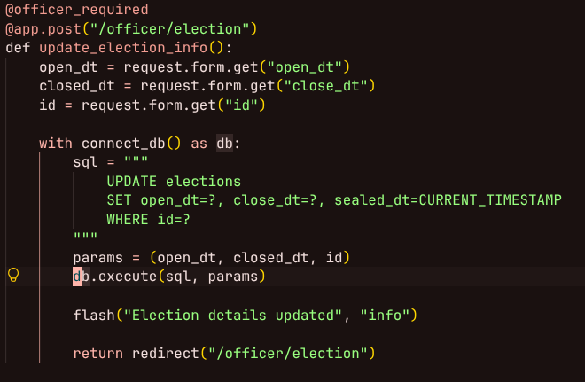
The id parameter for this query relies on the id fetched from the request.form.get function except the id is not a field in the form:
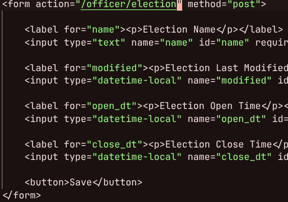
As such, the where clause fails in the sql and the election is not updated.

Fix: fixing this paradigm to be more conventional by passing the id through the url rather than a hidden form field that doesn't exist:

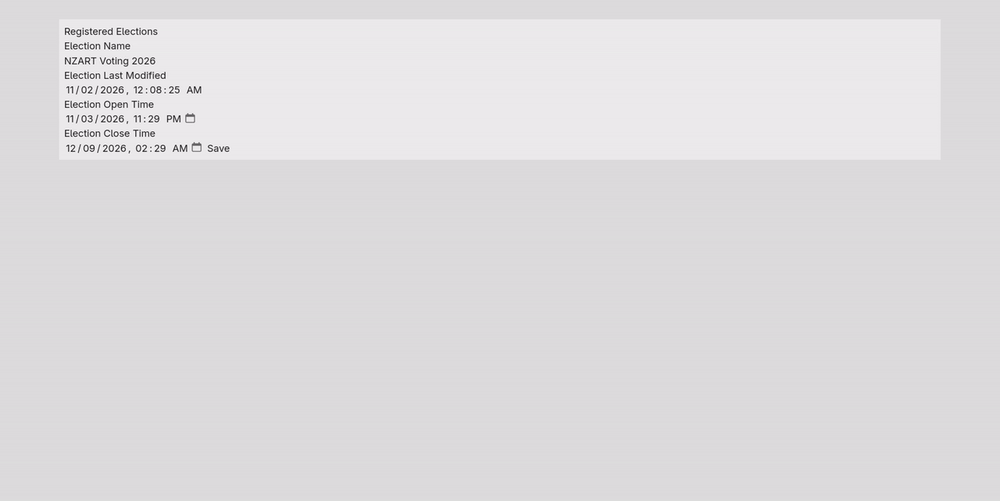

## Sprint Review

Replace this text with a statement about how the sprint has moved the project forward - key success point, any things that didn't go so well, etc.

